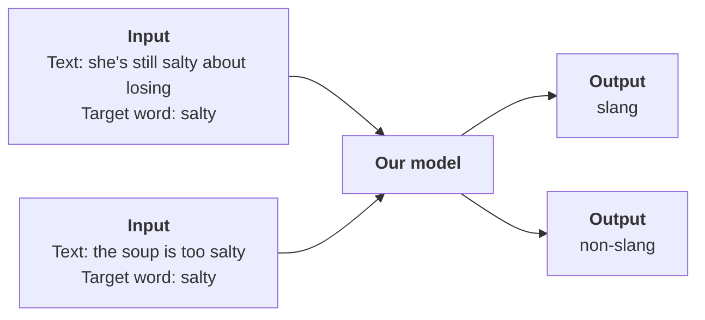
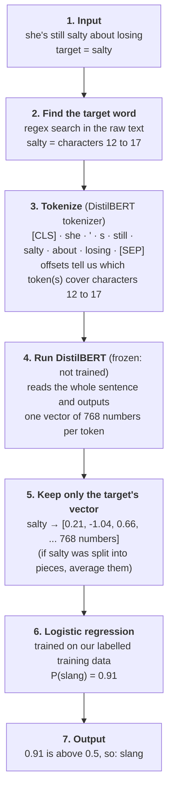
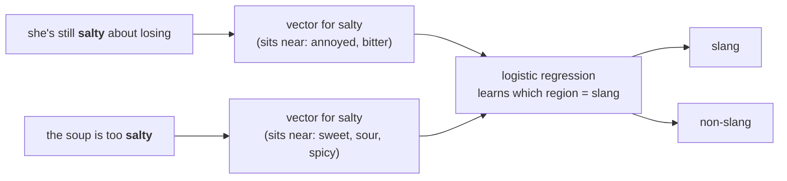
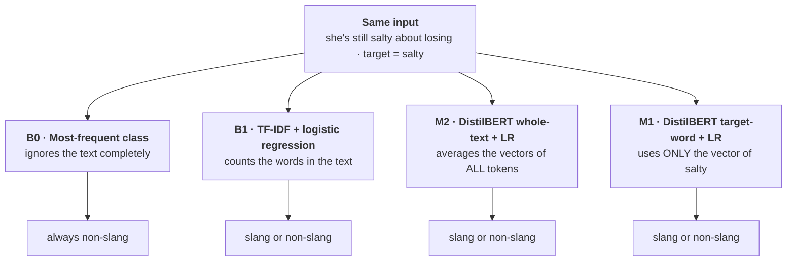
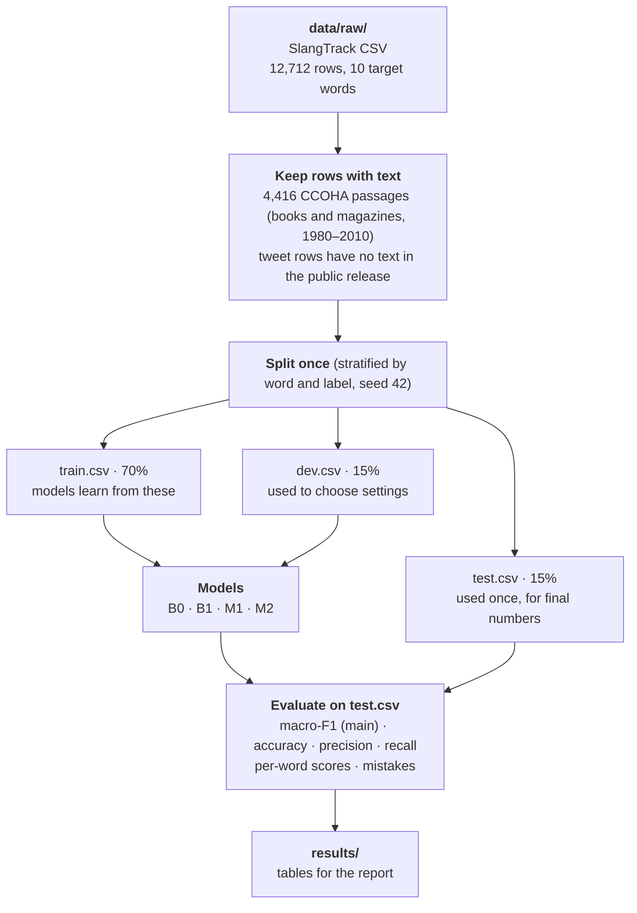
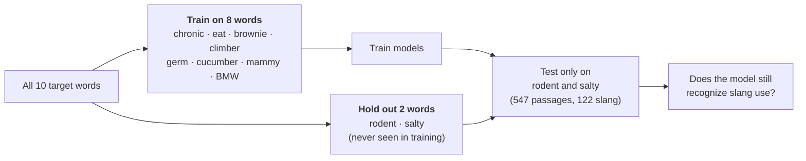

# How It Works: From a Sentence to "Slang" or "Non-slang"

A visual guide for anyone new to this repo. For the full explanation see `PROJECT_EXPLAINED.md`; for implementation details see `PLAN.md`.

> The probabilities, vector numbers and "sits near" words in these diagrams are **illustrative**, to show the idea. Real values come from running the code.

---

## 1. The big picture

We give the system a sentence and tell it which word to look at. It answers whether that word is used as slang.

Same word, different context, different answer. The model has to use the **context** to decide.

---

## 2. Inside the main model (M1), step by step

This is our main approach: **frozen DistilBERT target-word embedding + logistic regression**.

**Why step 5 matters.** DistilBERT gives *salty* a different vector depending on its neighbours, so the two sentences below produce different target-word vectors even though the word is spelled the same:

---

## 3. The four models we compare

Every model gets the same input and gives the same kind of output. They differ in **what they look at**.

| Model | What it looks at | Question it answers |
| --- | --- | --- |
| B0 | Nothing | What score do we get with no intelligence at all? |
| B1 | Which words appear | Are word counts enough? |
| M2 | Meaning of the whole text | Does a language model help? |
| M1 | Meaning of the target word in context | Does focusing on the target word help? (M1 vs M2 is our key comparison) |

---

## 4. The whole pipeline: data to results

---

## 5. The held-out-word experiment

Can a model detect slang in a word it has **never seen** in training?

We hold out *rodent* and *salty* because together they have 122 slang examples to test on. *Climber* was the first choice, but only 24 of its slang examples have text.

Example of what we're testing:

| Sentence | Correct answer |
| --- | --- |
| A **rodent** got into the kitchen. | non-slang |
| Don't trust him, he's a total **rodent**. | slang |

The model learned what slang *looks like* from the other 8 words. This test shows whether that knowledge transfers to new words, which matters because new slang appears all the time.
